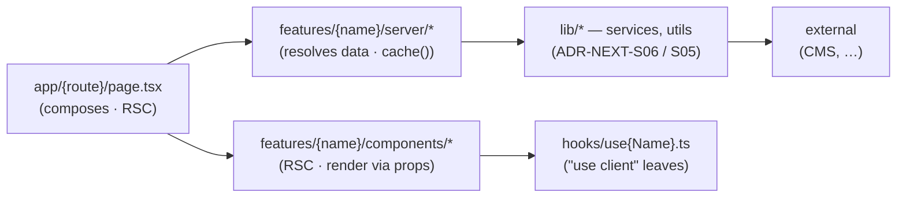

# ADR-NEXT-S03: Feature Structure

**Date:** 2026-06-27
**Status:** Accepted
**Class:** System (portable across Next.js SSR web projects)

> Companion to [ADR-NEXT-S01](ADR-NEXT-S01-repository-structure.md): S01 says *where* code lives (`src/features/<name>/` is the unit of implementation); this ADR says *what's inside* a feature and how its parts divide along the **RSC / client boundary**. A feature's `server/` resolves data through injected service modules — see [ADR-NEXT-S06](ADR-NEXT-S06-pure-service-modules.md) and ADR-NEXT-S05 (dependency injection).

## Problem

A Next.js (App Router) feature needs a consistent internal structure so that capability lands in the same places every time, the **server/client boundary is explicit** (RSC by default), data resolution stays on the server, and context loading stays targeted. Without a canonical feature anatomy, rendering, data fetching, and client interactivity drift into ad-hoc files — or worse, into the route — and become impossible to test or reuse.

The structure must scale from a static presentational section (components only) to a data-backed feature (server loaders + interactive client leaves) **without changing shape**.

**Context:**
- App Router + React Server Components by default; `"use client"` only at interactive edges.
- A feature is the unit of implementation (ADR-NEXT-S01); routes (`src/app/<route>/page.tsx`) compose features.
- Data is resolved on the server, in the feature's `server/`, via service modules injected per ADR-NEXT-S06 / ADR-NEXT-S05 — not fetched ad-hoc in components.
- No global client store and no SPA router: client state is local or URL-driven; routing is the App Router.
- Optimised for humans and LLMs finding code by convention.

## Decision

**One universal feature structure in `src/features/<name>/`, divided along the RSC/client boundary. Subfolders are optional add-ons that scale with feature complexity.**

Core principles:
1. All capability lives in `src/features/<name>/` — never at `src/` root, never inline in a route.
2. **Routes (`src/app/<route>/page.tsx`) compose features; a feature's `server/` resolves data on the server; `components/` are React Server Components by default, prop-driven; `hooks/` are client-only.**
3. `server/` owns data resolution — service calls + shaping, server-only, wrapped in `cache()`.
4. `hooks/` own client interactivity — `"use client"`, state/effects/browser APIs, no server imports.
5. Cross-feature imports follow strict rules (see Rules): a feature is reached only through its public API.

### Feature anatomy

Every feature lives in `src/features/<name>/`:

```
src/features/<name>/
├── components/            # feature UI — React Server Components unless interactive
│   └── <Component>.tsx    # PascalCase, one component per file
├── server/                # server-only data resolution + service calls (RSC)
│   └── <loader>.ts        # kebab-case; fetch + shape; wrap in cache(); returns domain types
├── hooks/                 # client-only hooks — "use client"
│   └── use<Name>.ts       # camelCase, always use* prefix; state/effects/handlers
├── types/                 # feature-owned TypeScript types
│   └── <name>.types.ts
└── index.ts               # optional public API re-exports (the feature's deliberate surface)
```

**Always present:** 
- `components/` (a feature renders something). 
**Add when needed:** 
- `server/` (any feature that resolves data), 
- `hooks/` (any client interactivity), 
- `types/` (non-trivial types), 
- `index.ts` (only when another feature consumes this one). 
A minimal presentational feature may be `components/` alone.

**Deliberately absent:**
- **No `screens/`.** Route targets are `src/app/<route>/page.tsx` (App Router) — see ADR-NEXT-S01. A feature exposes components and loaders; the route composes them. A second route layer inside the feature would duplicate `app/<route>/page.tsx`.
- **No `store/`.** There is no global client store. Server state is resolved in `server/` and passed down as props; client state is local (`useState`/`useReducer`) or URL-driven (`searchParams`).

### File naming

| Type | Convention | Example |
|---|---|---|
| Components | `PascalCase.tsx`, one per file | `PostList.tsx`, `BookingForm.tsx` |
| Client hooks | `use<Name>.ts` (file starts `"use client"`) | `useScrollSpy.ts`, `useFilters.ts` |
| Server modules | `kebab-case.ts` (in `server/`) | `get-posts.ts`, `load-booking.ts` |
| Types | `<name>.types.ts` | `blog.types.ts` |
| Tests | co-located `<name>.test.ts(x)` | `get-posts.test.ts` |

**Why fixed names:** IDE tabs and LLM file search are navigable — `PostCard.tsx` is
findable; eight tabs named `Card.tsx` are not. The convention also *signals the boundary*:
`use*` is a client hook, `kebab-case.ts` under `server/` is server-only.

### File responsibilities

| File | Contains | NEVER contains |
|---|---|---|
| `components/<Component>.tsx` | Rendering, prop-driven — RSC by default; an interactive leaf adds `"use client"` | Data fetching or service calls — it never resolves its own data |
| `server/<loader>.ts` | Server-only fetch + shaping; wrap reads in `cache()`; returns domain types | JSX; `"use client"`; client-only/browser APIs |
| `hooks/use<Name>.ts` | `"use client"` state, effects, handlers, browser APIs | Server-only imports (`server/*`, secrets, `cache()`); JSX that should be a component |
| `types/<name>.types.ts` | Types this feature defines and produces | Types owned by another feature |
| `index.ts` | Deliberate public re-exports | Re-exporting internals you don't want other features to consume |

### Composition & dependency direction



The route resolves dependencies and composes the feature; `server/` resolves data on the server; `components/` render that data via props; `hooks/` add interactive client leaves. 
**Lower layers never import upward** — `components/` render the props they're given (they don't fetch), and `hooks/` never import `server/`. A feature reaches another feature only through its `index.ts` (or a type-only import from its `types/`); everything else shared goes up into `@/components` or `@/lib`.

## Rules

1. **Everything in `src/features/<name>/`.** A cohesive capability owns its components, server loaders, hooks, and types here — never at `src/` root, never inline in a route.
2. **Routes compose; features implement.** `src/app/<route>/page.tsx` is the only route target — it resolves dependencies (services via factories, ADR-NEXT-S06 / ADR-NEXT-S05) and composes the feature. There is no `screens/` folder; App Router routes already are the entry points.
3. **`components/` are React Server Components by default.** Prop-driven, no data fetching. Add `"use client"` only when a leaf needs interactivity or browser APIs — keep client components small and push them to the edges of the tree.
4. **`server/` resolves data, server-only.** Loaders fetch and shape through injected service modules (ADR-NEXT-S06), return domain types, and wrap reads in React `cache()` for per-request memoization. `server/` never returns JSX and never runs on the client.
5. **`hooks/` are client-only.** Each file starts with `"use client"` and owns state, effects, handlers, and browser APIs. A hook never imports from `server/` and never reads secrets. No global store: client state is local or URL-driven (`searchParams`); there is no `store/` folder.
6. **File naming is fixed** (see *File naming*) — `PascalCase.tsx` components, `use<Name>.ts` client hooks, `kebab-case.ts` server modules, `<name>.types.ts` types.
7. **Each file keeps to its responsibility** (see *File responsibilities*) — a component that fetches, a loader that returns JSX, or a hook that imports `server/` is a boundary violation, not a shortcut.
8. **Features never reach into each other's internals.** *Allowed* across features: another feature's `index.ts` (its deliberate public API) and `types/*` (type-only). *Forbidden*: another feature's `components/*`, `hooks/*`, or `server/*` directly. Shared code goes up into `@/components` or `@/lib`; cross-feature data work resolves through the same injected services (ADR-NEXT-S05), not a sibling's `server/`.
9. **Types belong to the feature that produces them** — `features/<name>/types/<name>.types.ts`. Domain-agnostic generics (e.g. `Paginated<T>`) live in `@/lib`. No root-level `src/types.ts` dump; don't pre-create types for features that don't exist yet (YAGNI); cross-feature use is a type-only import.
10. **Directory by default.** Use `src/features/<name>/` even for a small feature; a flat `src/features/<name>.ts` is only for a trivial constant-only module. Promoting flat → directory later forces import rewiring across consumers — when in doubt, start with the directory.
11. **Tests co-locate** with the unit they cover (`<name>.test.ts(x)`), run via `make test`.

### Adding a new feature

1. Create `src/features/<name>/`.
2. Add `components/`; add `server/`, `hooks/`, `types/` as the feature needs them.
3. Define types in `types/<name>.types.ts`.
4. Implement `server/` loaders — server-only, `cache()`-wrapped, resolving services via the injected contract (ADR-NEXT-S06 / ADR-NEXT-S05).
5. Implement `components/` as RSC, prop-driven (no fetching).
6. Add `hooks/` only where the UI needs client interactivity (`"use client"`).
7. Expose a public API via `index.ts` only if another feature must consume this one.
8. Co-locate tests (`*.test.ts(x)`).
9. **Wire the route in `src/app/<route>/page.tsx`** — the route resolves dependencies and composes the feature.

## Alternatives considered

| Option | Verdict |
|--------|---------|
| One universal `src/features/<name>/` split by the RSC/client boundary (chosen) | **Chosen** — predictable; server/client seam visible in the folder layout; scales from static section to data-backed feature without changing shape |
| "Route is the feature" — logic inside `src/app/<route>/` | Rejected — pages accrete logic; no reuse across routes; hard to test (echoes ADR-NEXT-S01) |
| `screens/<Name>Screen.tsx` route-target components inside the feature | Rejected — App Router routes already are the entry points; a `Screen` layer duplicates `app/<route>/page.tsx` |
| `store/` (global client store) per feature | Rejected — RSC resolves data on the server; client state is local or URL-driven; a global store is unjustified weight under SSR |
| Flat single-file features | Rejected — no room for the server/client split; forces rewiring the moment the feature grows |

## Consequences

**Positive:** one pattern for every feature, from static section to data-backed capability; the RSC/client boundary is legible in the folder layout and the filename; data resolution stays on the server and is testable without a browser; predictable locations for humans and LLMs; cross-feature coupling is blocked by the import rules.

**Negative:** more files per feature than a single-file approach; discipline required to keep data fetching out of `components/` and `server/` out of client bundles — enforced by the `"use client"`/server-only boundary, the import rules, and code review.

## Related

- **Lives under:** [ADR-NEXT-S01](ADR-NEXT-S01-repository-structure.md) (repository structure) — `src/features/<name>/` is the unit of implementation; this ADR is its internal anatomy.
- **Service modules:** [ADR-NEXT-S06](ADR-NEXT-S06-pure-service-modules.md) (pure service modules) — what a feature's `server/` calls (the `src/lib/<service>/` seam).
- **Dependency injection:** ADR-NEXT-S05 — how `server/` receives services (injected per request, not module-scope singletons).
- **Frontend stack:** ADR-NEXT-S02 — the Next.js / React 19.2 / RSC choices this anatomy assumes.
- **Conventions:** [`../conventions.md`](../conventions.md) — full how-to for component / loader / hook patterns.
- **Vision:** [`../vision.md`](../vision.md).
